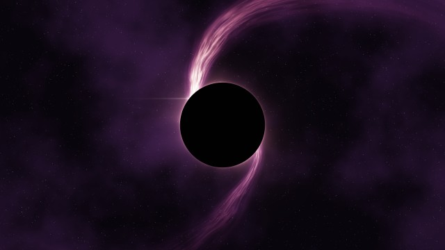
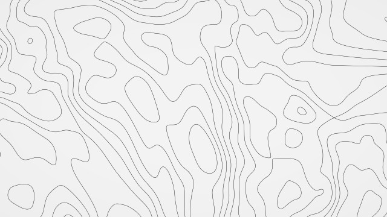
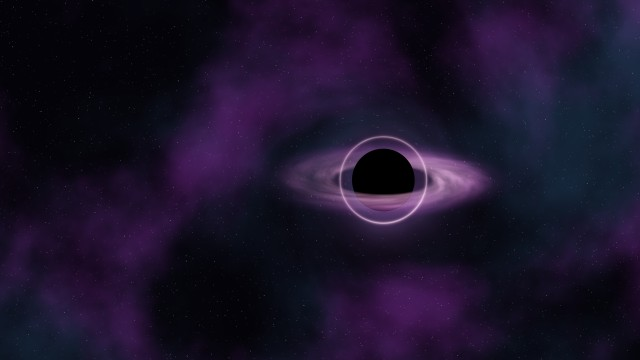
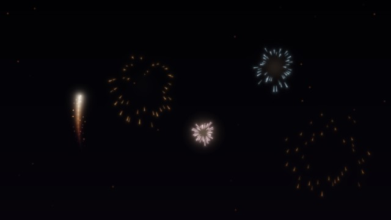
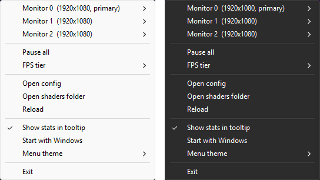

# wallp

Animated shader wallpapers for Windows 10 and 11. Every monitor gets its own HLSL shader,
drawn behind the desktop icons. It stops drawing whenever the desktop can't be seen (a
fullscreen app, windows covering the screen, a locked or sleeping PC, or you being away),
and slows down while a game or a video is using the GPU. On my PC, three 1080p screens
animating together use well under 1% CPU and about 16 MB of RAM. When paused it uses next
to nothing.

<table>
  <tr>
    <td><br><sub>eclipse</sub></td>
    <td><br><sub>startrails</sub></td>
    <td><br><sub>ribbons</sub></td>
  </tr>
  <tr>
    <td><br><sub>topo_neon</sub></td>
    <td><br><sub>topo</sub></td>
    <td><br><sub>topo_light</sub></td>
  </tr>
  <tr>
    <td><br><sub>lens (follows the mouse)</sub></td>
    <td><br><sub>sparks (click for fireworks)</sub></td>
    <td><br><sub>field (follows the mouse)</sub></td>
  </tr>
</table>

There are a few more in `shaders\`: plasma, stars, clouds, gradient, clock, spotlight and
topo_touch.

## Usage

Download the zip from [Releases](https://github.com/parrotlive/wallp/releases), unzip it
anywhere and run `wallp.exe`. It sits in the tray. Right-click the icon to pick a shader for
each monitor, pause everything, or make it start with Windows. The menu follows the
taskbar's light or dark mode, and you can also force either one.



Settings live in `config.json` next to the exe, which is created on first run. The frame rate
tiers, the idle timeout and the lists of games and video players are all in there. Changes
to the config and to shaders apply as soon as you save. If a shader doesn't compile you get a
notification with the line number, and the previous version keeps running.

## Writing shaders

Shaders work like on Shadertoy, written in HLSL:

```hlsl
void mainImage(out float4 col, float2 fragCoord) {
    float2 uv = fragCoord / iResolution.xy;
    col = float4(uv, 0.5 + 0.5 * sin(iTime), 1.0);
}
```

Save it as an `.hlsl` file in `shaders\` and it appears in the menu. Besides the usual
`iResolution`, `iTime`, `iFrame` and `iDate` there's `iMonitor`, the battery level and a few
more. With `"mouse": true` in a sidecar file you also get the cursor, its speed, its recent
path and the last few clicks. All of them are listed with comments at the top of
[src/shader.cpp](src/shader.cpp).

The sidecar has the same name as the shader with `.json` instead, for example `lens.json`:

```json
{ "mouse": true, "maxFps": 60, "renderScale": 1.0 }
```

`maxFps` caps that shader and `renderScale` draws it at a lower resolution, which helps
for heavy ones. Files starting with `_` are includes, such as `_noise.hlsli`, `_topo.hlsli`
and `_mouse.hlsli`, and they don't show up in the menu.

## Building

You need Visual Studio 2019 or 2022, or just the Build Tools, with the C++ desktop workload.
Run `build.bat`. It writes `build\wallp.exe` and copies the shaders next to it.

JSON parsing uses [yyjson](https://github.com/ibireme/yyjson) (MIT), included in
`third_party\`.
